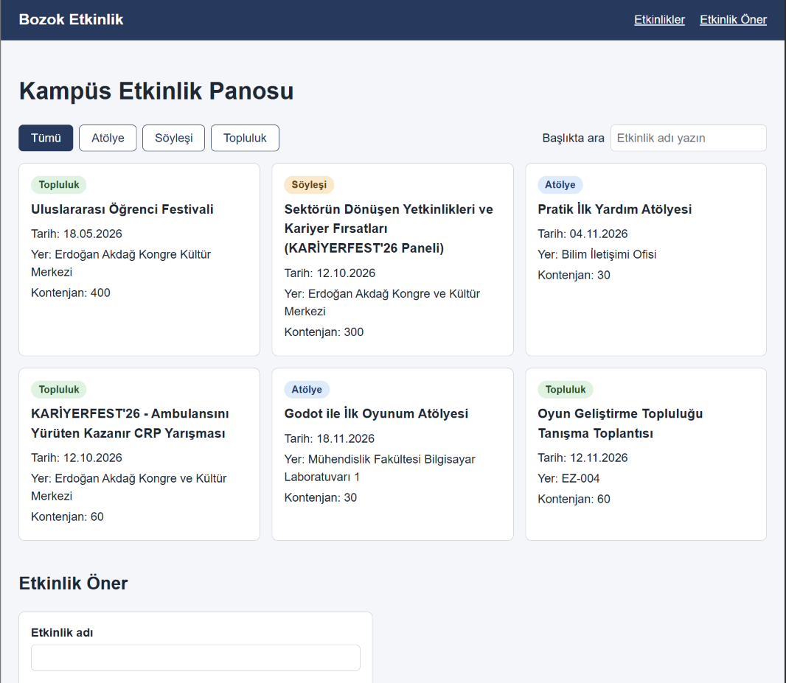

# Kampüs Etkinlik Panosu

Bu proje, Yozgat Bozok Üniversitesi öğrencilerinin kampüsteki atölye, söyleşi ve topluluk etkinliklerini güncel olarak tek bir yerden takip edebilmeleri için geliştirilmiş bir web uygulamasıdır. Kullanıcılar yaklaşan etkinlikleri türlerine göre filtreleyebilir, isme göre arayabilir ve panoda yer almasını istedikleri yeni etkinlikleri form aracılığıyla önerebilirler.

BMH231 Web Programlama dersi Ödev 2 için hazırlanmıştır. Node.js'in yerleşik `http` modülüyle yazılmış bir sunucu ve HTML, CSS, JavaScript ile yazılmış bir sayfadan oluşur.

## Kurulum ve çalıştırma

```
git clone https://github.com/NisanurErdogan/bmh231-odev2.git
cd bmh231-odev2
npm start
```

Sonra tarayıcıda http://localhost:3000 adresini açın. (Bilgisayarda Node.js kurulu olmalıdır.)

## API uç noktaları

| Yöntem                  | Yol                           | Durum | Açıklama                          |
| ----------------------- | ----------------------------- | ----- | --------------------------------- |
| GET                     | `/api/etkinlikler`            | 200   | Tüm etkinlikler (JSON)            |
| GET                     | `/api/etkinlikler?tur=atolye` | 200   | Yalnızca o türdeki etkinlikler    |
| GET                     | `/api/etkinlikler/3`          | 200   | Tek etkinlik (JSON)               |
| GET                     | `/api/etkinlikler/999`        | 404   | `{"hata": "Etkinlik bulunamadı"}` |
| GET                     | Diğer bulunmayan yollar       | 404   | Düz metin                         |
| GET dışındaki yöntemler | Herhangi                      | 405   | `Allow: GET` başlığı              |

## Ekran görüntüsü



## Veri kaynağı

Etkinlik verilerinin çoğu Yozgat Bozok Üniversitesi etkinlik takvimi ve topluluklar sayfalarındaki etkinliklerden alınmıştır. Oyun Geliştirme Topluluğu etkinlikleri kurgusal ama gerçekçi örneklerdir. Kontenjan değerleri tahminidir.
